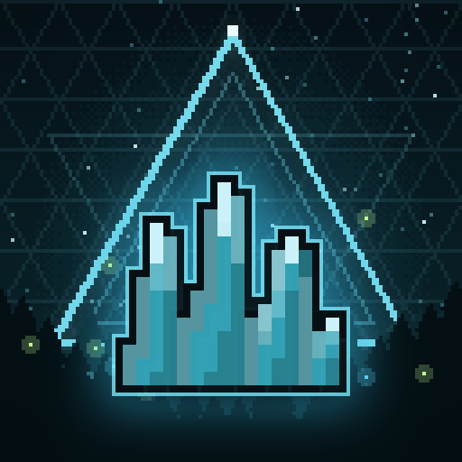

# Lepton



[](https://github.com/MiracleForest/Lepton/actions/workflows/build.yml)
[](LICENSE)

Lots of small things that make vanilla better, each one a module you can turn off. Lepton is a LeviLamina mod for Minecraft Bedrock Edition, for dedicated servers and single-player worlds.

## Features

[docs/SPEC.md](docs/SPEC.md) has the details of every module and the [features that are not on Bedrock](docs/SPEC.md#8-not-ported).

- **Automation**: chains that pull blocks along, iron rods, piston rules, gravisand, metal buttons, the obsidian pressure plate, the redstone randomizer, the ender watcher, block-placing dispensers, chutes and feeding troughs.
- **Building**: vertical slabs, stone and brick variants, palette blocks (shingles, framed glass, gold bars, industrial and Japanese palettes, thatch, grates), wood variants (vertical planks, bookshelves, ladders, posts, hedges, leaf carpets, hollow logs), compressed blocks, stools, rope, variant chests and furnaces, crystal lamps and glass item frames.
- **Management**: inventory sorting, easy transferring, chest searching, the hotbar changer, tool restock, quick armour swapping, expanded item interactions and item sharing.
- **Tools**: pickarangs, torch arrows, parrot eggs, skull pikes, bottled clouds, slime in a bucket, ancient tomes, colour runes, beacon redirection, the abacus, pathfinder maps, ambience discs, the trowel and the seed pouch.
- **Oddities**: matrix enchanting, the backpack, the Totem of Holding, copper pipes, crates, magnets and the tiny potato.
- **Mobs**: crabs, shibas, oretoises, stonelings, the Forgotten, foxhounds and wraiths.
- **Tweaks**: simple harvesting, hoe harvesting, reacharound placing, rotation lock, enhanced ladders, emotes, patting the dogs, double doors, better sponges, utility recipes, map washing, dyeable item frames and many smaller ones.
- **World**: the azalea, trumpet and ashen woods, new stones and permafrost, big stone clusters, corundum, fairy rings, fallen logs, monster boxes, the Glimmering Weald, Nether obsidian spikes, chorus vegetation and spiral spires.
- **Client** (needs the client mod): usage ticker, elytra indicator, improved tooltips, auto-walk, back button, long-range pick block, greener grass, variant animal skins, bucket icons and camera mode.

Players on a Lepton server don't need the client mod: the server sends its resource pack, and features with a screen fall back to forms, vanilla container screens or the `/lepton` commands below. HUD, tooltip and keybind features need the client mod.

## Install

You need Minecraft Bedrock Edition for Windows (x64) with LeviLamina (on a client, installed through [LeviLauncher](https://github.com/LiteLDev/LeviLauncher)). A Lepton release is built against each LeviLamina line it supports, and you pick the one that matches your game:

| Minecraft | LeviLamina | Variant |
| --- | --- | --- |
| 1.26.60 | 26.60.x | `26_60`, and the default |
| 1.26.51 | 26.51.x | `26_51` |

In LeviLauncher, install Lepton from the **LeviMC Mods** page; it offers the variants above, and the default is the newest line.

With [lip](https://github.com/LiteLDev/lip) 0.40.0 or later, on a dedicated server or a client (lip picks the build of the side it installs to):

```sh
lip install github.com/MiracleForest/Lepton          # the newest line (26.60)
lip install github.com/MiracleForest/Lepton#26_51    # Minecraft 1.26.51
```

lip installs only one variant of Lepton at a time. To switch an installed Lepton to another line, uninstall it first
(`lip uninstall github.com/MiracleForest/Lepton`, with the variant it was installed as, such as `#26_51`), then
install the other variant. Your settings in the `config` folder are kept.

Or download the ZIP for your line and side from the [releases page](https://github.com/MiracleForest/Lepton/releases) (pre-releases such as betas are listed there too, but not under "Latest") and extract it into a `Lepton` folder, so that `Lepton/manifest.json` exists:

| Where | ZIP | Folder |
| --- | --- | --- |
| Dedicated server, 1.26.60 | `lepton-server-win-x64-ll26.60.zip` | `mods/Lepton/` |
| Client (LeviLauncher), 1.26.60 | `lepton-client-win-x64-ll26.60.zip` | `mods/Lepton/` |
| Dedicated server, 1.26.51 | `lepton-server-win-x64-ll26.51.zip` | `plugins/Lepton/` |
| Client (LeviLauncher), 1.26.51 | `lepton-client-win-x64-ll26.51.zip` | `mods/Lepton/` |

## Commands

| Command | Who | What it does |
| --- | --- | --- |
| `/lepton reload` | Operators, console | Reloads the configuration and translations. |
| `/lepton sort [container]` | Everyone | Sorts your inventory, or the container you look at. |
| `/lepton transfer insert\|extract [filtered]` | Everyone | Moves items into or out of the container you look at. |
| `/lepton hotbar [1-3]` | Everyone | Swaps the hotbar with an inventory row (a form without a row). |
| `/lepton shulker` | Everyone | Opens the shulker box in your main hand. |
| `/lepton share` | Everyone | Shares the item in your main hand in chat. |
| `/lepton emote [name]` | Everyone | Plays an emote (`wave`, `custom:<file>`, ...); a form without a name. |
| `/lepton lockrotation [clear]` | Everyone | Rotation lock for players without the client mod. |
| `/lepton variant [name\|original]` | Everyone | Variant selector form, or picks a variant directly (VariantSelector enabled). |
| `/lepton crystals info` | Everyone | Hints about corundum, crystal lamps, beacon redirection and magnets. |
| `/lepton crystals magnetic` | Everyone | Tells whether the item in your hand is magnetic. |
| `/lepton newstones info` | Everyone | Hints about the new stones and permafrost. |
| `/lepton newstones sources [radius]` | Operators | Lists the stone cluster sources near you. |
| `/lepton locate glimmering_weald\|monster_box` | Operators | Finds the nearest Glimmering Weald or known monster box. |
| `/lepton worldgen stats` | Operators | Counts the features generated since the start. |
| `/lepton enchanting tome <enchantment>` | Operators | Gives an ancient tome. |
| `/lepton enchanting rune <colour>` | Operators | Applies a rune colour to the enchanted item in your hand. |
| `/lepton enchanting demo [anvil\|smithing\|fill]` | Operators | Test helpers for matrix enchanting, tomes and runes. |
| `/lepton gadgets quill <biome>` | Operators | Gives a Pathfinder's Quill for a biome. |
| `/lepton gadgets potato angry\|name <name>` | Operators | Tiny potato test helpers. |
| `/lepton seedpouch <item>` | Operators | Gives a full seed pouch. |
| `/lepton cosmetics gallery\|view <row>\|buckets\|pumpkin <cursed>\|carry` | Operators | Cosmetics previews. |
| `/lepton debug backpack\|totem\|hud\|form\|container` | Operators | Test helpers (fill the backpack, spawn a totem, tooltip test kit, test form, test container). |
| `/lepton net [ping]` | Operators, console | Lists who runs the client mod; pings the client mods. |
| `/lepton selftest ["glob"]` | Operators, console | Runs the in-game selftests. |

## Configuration

Settings live in `config/*.json` inside the mod folder (`mods/Lepton/`, or `plugins/Lepton/` on a 1.26.51 server). Each file is created with defaults on first start, and `/lepton reload` applies changes (content and world generation changes apply when a world loads). A unit's file has one `enable<Module>` switch per module plus that module's options: [docs/SPEC.md §5](docs/SPEC.md#5-configuration) lists every key and its default.

| File | Contents |
| --- | --- |
| `mod.json` | Lepton itself: `language` (`en_US`; server messages when a player's own language has no translation), `usePlayerLocale` (`true`), `requireResourcePack` (`true`; dedicated server: players must accept the resource pack). |
| `keybinds.json` | Client: the keys of Lepton's keybinds (also in the game's Controls settings). |
| `vslabs.json` | VerticalSlabs, SlabsToBlocks |
| `stones.json` | MoreStoneVariants, RawMetalBricks, SturdyStone, CelebratoryLamps |
| `newstones.json` | NewStoneTypes, Permafrost, BigStoneClusters, VanillaStoneClusters |
| `bricks.json` | MoreBrickTypes, SoulSandstone, MoreMudBlocks, Midori, DuskboundBlocks |
| `palette.json` | Shingles, FramedGlass, GoldBars, IndustrialPalette, JapanesePalette, NetherBrickFenceGate, Thatch, Grate |
| `woodvariants.json` | VerticalPlanks, VariantBookshelves, VariantLadders, WoodenPosts, Hedges, LeafCarpet, HollowLogs |
| `newwoods.json` | AzaleaWood, AncientWood, BlossomTrees |
| `storage.json` | CompressedBlocks, Stools, Rope, ShearVines, MorePottedPlants, GlassShard, UtilityRecipes |
| `variantcontainers.json` | VariantChests, VariantFurnaces |
| `redstone.json` | ChainsConnectBlocks, IronRod, PistonsMoveTileEntities (with `pistonPushLimit`), Gravisand, MetalButtons, ObsidianPlate, RedstoneRandomizer, EnderWatcher, DispensersPlaceBlocks |
| `logistics.json` | Chute, Pipes, FeedingTrough, Crate |
| `crystals.json` | Corundum, RainbowLamps, BeaconRedirection, Magnets |
| `enchanting.json` | MatrixEnchanting, AncientTomes, ColorRunes |
| `backpack.json` | Backpack, TotemOfHolding, SeedPouch |
| `inventory.json` | InventorySorting, EasyTransferring, ChestSearching, HotbarChanger, AutomaticToolRestock, QuickArmorSwapping, ExpandedItemInteractions, ItemSharing |
| `hud.json` | UsageTicker, ElytraIndicator, ImprovedTooltips, AutoWalkKeybind, BackButtonKeybind |
| `placement.json` | ReacharoundPlacing, LockRotation, VariantSelector, Trowel, ReplaceScaffolding, LongRangePickBlock, EnhancedLadders |
| `cosmetics.json` | GreenerGrass, VariantAnimalTextures, BucketsShowInhabitants, SoulCandles, WoolShutsUpMinecarts, UsesForCurses, MoreVillagers, Camera |
| `emotes.json` | Emotes, PatTheDogs (custom emotes go in `config/lepton_emotes/`) |
| `mobsoverworld.json` | Crabs, Shiba, Toretoise |
| `mobsdeep.json` | Stonelings, Forgotten, Foxhound, Wraith |
| `throwables.json` | Pickarang, TorchArrow, ParrotEggs, SkullPikes, BottledCloud, SlimeInABucket |
| `gadgets.json` | Abacus, PathfinderMaps, AmbientDiscs, EndermoshMusicDisc, CompassesWorkEverywhere, TinyPotato |
| `frames.json` | GlassItemFrame, DyeableItemFrames, MoreBannerLayers, MapWashing |
| `farming.json` | SimpleHarvest, HoeHarvesting, PigLitters, PoisonPotatoUsage, CoralOnCactus, RenewableSporeBlossoms, PetalsOnWater, GrabChickens, HorsesSwim, VillagersFollowEmeralds |
| `mobtweaks.json` | SaferCreatures, SlimesToMagmaCubes, SnowGolemPlayerHeads, VexesDieWithTheirMasters, ZombieVillagersOnNormal, DragonScales, GoldToolsHaveFortune, DiamondRepair, NoDurabilityOnCosmetics, ShulkerPacking, MagmaKeepsConcretePowder, ImprovedSponges, DoubleDoorOpening |
| `misctweaks.json` | BetterElytraRocket, CampfiresBoostElytra, MoreNoteBlockSounds, AutomaticRecipeUnlock, ArmedArmorStands, GameNerfs, SpawnerReplacer, VillagerRerollingRework, AdjustableChat, NarratorReadout, ClimateControlRemover (the OverlayShader and MicrocraftingHelper keys are kept but do nothing on Bedrock) |
| `worldsurface.json` | FairyRings, FallenLogs, MonsterBox, GlimmeringWeald, CherryGroveWaterPetals |
| `worldbeyond.json` | NetherObsidianSpikes, NoMoreLavaPockets, ChorusVegetation, SpiralSpires |

### Keybinds (client mod)

| Default key | Action |
| --- | --- |
| H | Hotbar changer (not Z, which is Bedrock's Mob Effects key) |
| K | Rotation lock |
| R (hold) | Variant selector (experimental, VariantSelector enabled) |
| F12 | Camera mode |
| Shift + T over a slot | Share the item (the chat key, in inventory screens) |
| Mouse button 5 | Back (`backMouseButton` in `hud.json`) |
| Not bound | Sorting, insert, extract, shift lock, auto-walk, narrator readout, each emote |

Change them in the game's Controls settings or in `config/keybinds.json`.

## Contributing

See [CONTRIBUTING.md](CONTRIBUTING.md). [AGENTS.md](AGENTS.md) is the developer guide.

## License

[CC BY-NC-SA 4.0](LICENSE) (Creative Commons Attribution-NonCommercial-ShareAlike 4.0 International). Lepton may not be sold or distributed for profit, including behind a paywall or on ad-supported download pages. See [NOTICE](NOTICE) for third-party notices.
